# Beginner Overview Rev.F — webRagSys 初心者向け解説

このドキュメントは、`webRagSys` を初めて読むPython中級者・RAG初心者のために書かれています。
Pythonの基本構文ではなく、FastAPIとLangChainによるRAGの仕組みに焦点を当てます。

Rev.F は Rev.E の継承版です。Rev.E の内容を維持し、文書と質問のEmbedding対象、ベクトルの形、次元数が多い場合の傾向を補足しています。Rev.E は変更していません。

---

## 1. プロジェクト全体構造と役割

### 1.1 このプロジェクトは何をするのか

**webRagSys** は、社内文書を登録し、その文書を根拠にAIが回答するWeb APIシステムです。

- 文書CRUD（Create登録／Read読出／Update更新／Delete削除）：タイトルと本文を登録・一覧・詳細・更新・削除します
- RAG化（Retrieval-Augmented Generation＝検索拡張生成）：文書を分割し、Embedding化してVector Databaseへ保存します
- AIチャット：質問をEmbedding化し、類似文書を検索してLLM（Large Language Model＝大規模言語モデル）が回答します
- 既定は偽実装：EmbeddingもLLMもFakeを使い、課金なしで学習できます

たとえるなら、文書管理は書庫係、RAGは索引係、LLMは回答係です。

<h4>LLMとRAG・文書管理の使う使われる関係（Rev.C追加）</h4>

<p>結論は、別の何か（RAGチェーン）がLLMを使う側である。LLMがRAGや文書管理を使うのではない。</p>

<p>理由は、中心が<code>src/rag/chain.py:answer_question</code>であり、<code>vectorstore.search</code>による類似検索と<code>llm/provider.py:generate_answer</code>による文章生成の順序だけを決めているためである。文書登録時（<code>documents.py</code>）は<code>chunker</code>と<code>vectorstore</code>のみを用い、LLMを用いない。</p>

<table>
<tr><th>主体</th><th>役割</th><th>実コード</th></tr>
<tr><td>chain.py</td><td>検索と生成の順序決定</td><td>answer_question</td></tr>
<tr><td>vectorstore.py</td><td>類似検索の実行</td><td>search</td></tr>
<tr><td>llm/provider.py</td><td>回答文生成の下請け</td><td>generate_answer</td></tr>
</table>

<p>具体例として、質問から回答までの流れは、chat.py → chain.py →（vectorstore ＋ llm）→ 回答の順である。</p>

<p>注意点として、1.1のたとえ（書庫係、索引係、回答係）は使う側の順序ではなく役割分担の説明である。</p>

### 1.2 フォルダ構成

```text
webRagSys/
├── AGENTS.md              ← 作業規約（必読）
├── README.md              ← 使い方入門書
├── config.py              ← 設定集約（DB、RAG、LLM切替）
├── requirements.txt       ← 依存一覧
├── Dockerfile             ← APIイメージ定義（構成見本、起動対象外）
├── docker-compose.yml     ← API＋PostgreSQL＋pgvector構成（構成見本、起動対象外）
├── .env.example           ← 公開用設定見本（実キーは書かない）
├── src/api/main.py        ← 起動点（create_app、ルータ登録）
├── src/api/routers/       ← documents.py（CRUD）、chat.py（質問応答）
├── src/schemas/           ← Pydantic入出力定義
├── src/db/                ← database.py（接続）、models.py（2テーブル）
├── src/rag/               ← chunker、embeddings、vectorstore、chain
├── src/llm/               ← provider.py（切替）、fake_provider.py（偽回答）
├── tests/                 ← test_documents.py、test_chat.py、conftest.py
├── docs/                  ← 本書、handover.md、assets/（図PNG）
├── .venv/                 ← 仮想環境（Git除外、各自作成）
└── diagrams/              ← 図の元データ（Mermaid形式）
```

**注意点**：Dockerfileとdocker-compose.ymlは構成見本であり、storage制約のため起動検証の対象外です。正規の動作確認はローカル起動（uvicorn＋SQLite）で行います。

### 1.3 各フォルダの担当

| フォルダ | 役割 | たとえると… |
|---------|------|------------|
| `src/api/` | HTTP受付と振分 | 受付窓口 |
| `src/schemas/` | 入出力の検品 | 受付票の雛形 |
| `src/db/` | 保存と読出 | 書庫 |
| `src/rag/` | 分割・検索・回答組立 | 索引係と下書き係 |
| `src/llm/` | 文章生成 | 回答係 |
| `tests/` | 品質保証 | 検品係 |
| `docs/` | 設計書・説明書 | マニュアル |

### 1.4 主要ファイルの役割

| ファイル | 担当 | 重要なポイント |
|---------|------|--------------|
| **config.py** | 設定集約 | `USE_FAKE=true`既定、`chunk_size=500`、`top_k=3` |
| **src/api/main.py** | app生成 | `create_app()`でルータ登録する |
| **src/api/routers/documents.py** | CRUD | 登録・更新時にchunks再生成する（57、104行目） |
| **src/db/models.py** | 2テーブル | `documents`と`document_chunks`、Postgres時はVector型 |
| **src/rag/chunker.py** | 分割 | LangChain優先、なければ単純分割に退避する |
| **src/rag/embeddings.py** | ベクトル化 | Fake既定、本番のみOpenAI通信する |
| **src/rag/vectorstore.py** | 保存検索 | 置換保存、コサイン類似検索する |
| **src/rag/chain.py** | 回答手順 | 検索→整形→生成の順序だけを決める |
| **src/llm/provider.py** | 切替 | Fakeか本番かを1か所で決めます |

### 1.5 技術スタック一覧と使い方概要

`requirements.txt`、`docker-compose.yml`、`config.py`の実測に基づきます。

| 技術 | 版・実態 | 使い方概要 | 主な使用箇所 |
|------|----------|------------|--------------|
| Python | 3.11実測、3.10互換です | 全実装の言語です | 全体です |
| FastAPI | 0.110以上です | HTTP受付と振分、入出力検証です | `src/api/main.py`、`src/api/routers/`です |
| uvicorn | 0.29以上です | 起動サーバです | `uvicorn src.api.main:app --reload`です |
| SQLAlchemy | 2.0以上です | 文書とチャンクの保存読出です | `src/db/database.py`、`src/db/models.py`です |
| psycopg2-binary | 2.9以上です | PostgreSQL接続駆動です | `src/db/database.py:_create_engine`です |
| pgvector | 0.3以上、DBはpgvector/pg16です | ベクトル列型の提供です | `src/db/models.py:_embedding_column`です |
| Pydantic / pydantic-settings / python-dotenv | 2.6以上 / 2.2以上 / 1.0以上です | 入出力雛形と設定集約です | `src/schemas/`、`config.py`です |
| LangChain一式 | langchain、langchain-community、langchain-openai、langchain-postgres、langchain_text_splittersです | 分割とEmbeddingと生成の枠組みです | `src/rag/chunker.py`、`src/rag/embeddings.py`、`src/llm/provider.py`です |
| SQLite | 標準組込です | PostgreSQL不在時の退避先です | `src/db/database.py`、`src/db/models.py:JSON代替`です |
| pytest / httpx | 8.0以上 / 0.27以上です | 偽実装による無課金試験です | `tests/`です |
| ruff | 0.4以上です | 検査です | `src`、`tests`、`config.py`です |
| Docker / docker-compose | 構成見本、起動検証対象外です | APIとPostgreSQL構成の見本です | `Dockerfile`、`docker-compose.yml`です |

正規の動作確認はローカル起動（uvicorn＋SQLite）で行います。

---

## 2. モジュール間の依存関係

### 2.1 依存関係の全体像

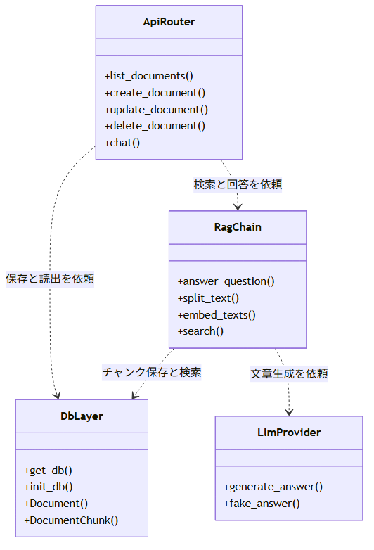

<details>
<summary>図の元データ（Mermaid）</summary>

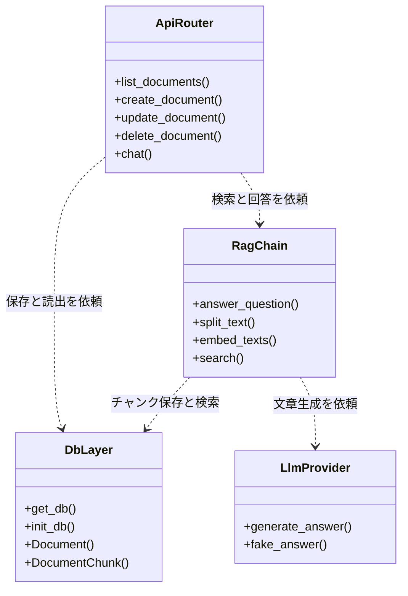
</details>

### 2.2 依存の方向性

webRagSysでは **「API → RAG → DB／LLM」** の一方通行で依存します。

```text
src/api/main.py（create_app）
  ├── src/api/routers/documents.py（CRUDを依頼）
  │     ├── src/db/models.py（保存）
  │     └── src/rag/chunker.py＋vectorstore.py（RAG化）
  ├── src/api/routers/chat.py（質問応答を依頼）
  │     └── src/rag/chain.py（answer_question）
  │           ├── src/rag/vectorstore.py（類似検索）
  │           └── src/llm/provider.py（文章生成）
  └── src/db/database.py（DB初期化）
```

**「一方通行」が重要な理由**：`src/db/` が `src/api/` を参照することはありません。これによってDB実装をPostgreSQLから他DBへ変えてもAPI層に影響が出ません。

### 2.3 `import` のしくみ — なぜ遅延importするのか

```python
# src/db/database.py：init_db内で遅延importする
from src.db import models  # テーブル登録のため
```

**読み方のコツ**：通常の`import`はファイル先頭に書きますが、循環参照を避けたい場合だけ関数内で書きます。ここでは`database.py`と`models.py`が互いを参照するため、実行直前に読み込む方式にしています。

**行わなければ何が起きるのか**：`src/db/models.py:18`は`from src.db.database import Base, engine`で`Base`を要求します。`database.py`の先頭で`from src.db import models`と書くと、`Base = declarative_base()`の定義前に`models.py`の読込が始まり、`ImportError: cannot import name 'Base' from partially initialized module`で起動しません。`init_db`内の遅延読込は`Base`と`engine`の生成後に`models.py`を読むため、この衝突を避けられます。同様に`embeddings.py:57`と`llm/provider.py:38`の`langchain_openai`遅延読込と`models.py:34`の`Vector`遅延読込は、未導入環境でも先頭読込時の`ImportError`を出さずFake動作とSQLite退避を可能にします。

### 2.4 呼び出しの流れ（具体例）

```python
# documents.py:57（登録時にRAG化する）
vectorstore.save_chunks(db, doc.id, chunker.split_text(doc.content))

# chain.py（質問時の流れ）
hits = vectorstore.search(db, question)  # 類似検索
context = "\n".join(h.content for h in hits)  # 類似文を結合
answer = generate_answer(question, context)  # LLM生成
```

---

## 3. データの流れ（3つのフェーズ）

webRagSysのデータは **「登録する → RAG化する → 質問に答える」** の3段階で流れます。

### 3.1 全体フロー

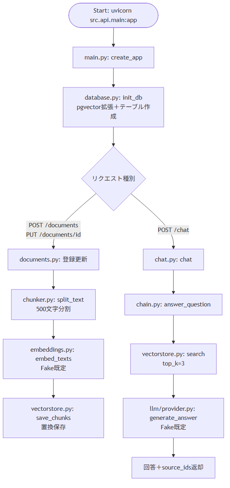

<details>
<summary>図の元データ（Mermaid）</summary>

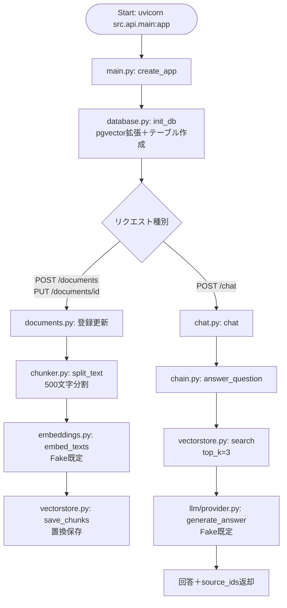
</details>

**注意点**：上図は初学者向けの簡略図です。GET（一覧・詳細）とDELETEの分岐を省略しています。完全な分岐は`diagrams/01_flowchart_RevA.md`で確認できます。

### 3.2 フェーズ1：文書登録（外部 → DB）

CRUDの5APIが`documents`テーブルを操作します。

| API | 処理 | RAG連動 |
|-----|------|---------|
| POST /documents | 挿入 | chunks生成する |
| PUT /documents/id | 更新 | chunks置換する |
| DELETE /documents/id | 削除 | chunks削除する |
| GET /documents | 一覧 | 連動なし |
| GET /documents/id | 詳細 | 連動なし |

**置換保存の理由**（`vectorstore.py:55`）：更新時に古いベクトルが残ると誤検索の原因になるため、一度全削除してから挿入し直します。

**扱える文書の種別**：現状はテキストのみです。`src/schemas/document.py`で`title`は1文字以上200文字以下、`content`は1文字以上と定め、`src/db/models.py`で`content`を`Text`列に保存します。入力経路は`POST /documents`のJSON本文だけであり、PDFやWordや画像や音声の直接受付はありません。ファイル添付欄は`/docs`に表示されないのが正常です。PDFやWord対応は`src/rag/chunker.py`の今後の拡張対象です。

### 3.3 フェーズ2：RAG化（文書 → ベクトル）

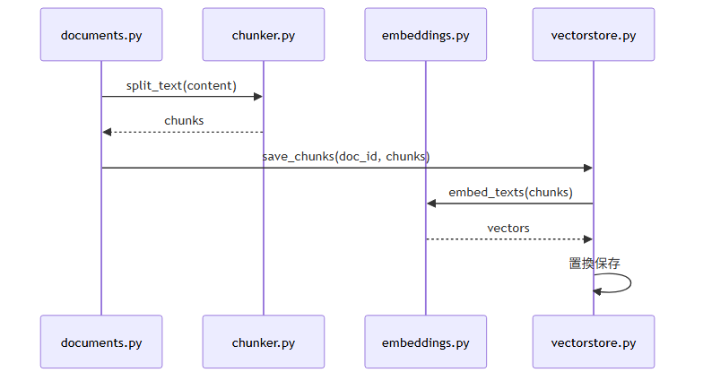

<details>
<summary>図の元データ（Mermaid）</summary>

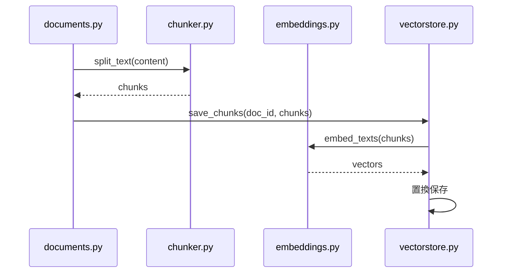
</details>

RAG初心者向けの要点：

- **チャンク**：長文を500文字単位に切った断片です。検索精度とLLM入力長の調整役です。
- **Embedding**：文章を数値ベクトル化する処理です。意味の近さが数値の近さになります。
- **SQL検索との違い**：SQLは完全一致探し、ベクトル検索は意味の近さ探しです。「休暇は何日」と「年次休暇は10日」は文字は違いますが意味が近いため検索できます。

### 3.4 フェーズ3：質問応答（質問 → 回答）

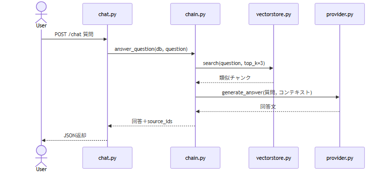

<details>
<summary>図の元データ（Mermaid）</summary>

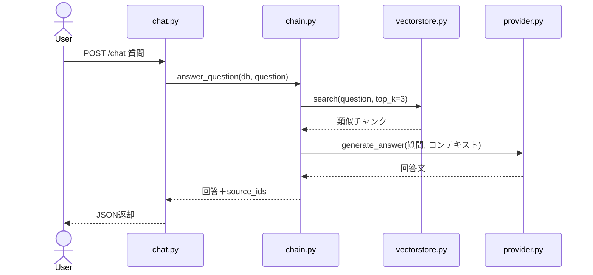
</details>

**データベースのテーブル構成**：

```text
documents（文書本体）
  │
  └── document_chunks（RAG用断片）
        └── document_id で紐づく
        └── chunk_index、content、embeddingを保持
```

---

## 4. 中級者がつまずきやすいポイント

### 4.1 FastAPI編

#### FastAPIの `Depends(get_db)`（documents.py:62）

```python
def list_documents(db: Session = Depends(get_db)) -> list[Document]:
```

**何をしているのか**：「このAPIを呼ぶ前に`get_db()`を実行し、その結果を`db`引数に入れてほしい」という宣言です。

**なぜ必要なのか**：DB接続の開閉を各APIに書くと重複します。`Depends`に任せると、成功時はセッション提供、終了時は自動closeになります。テスト時は`dependency_overrides`で偽DBに差し替えられます（`tests/conftest.py`）。

**間違えやすいポイント**：`Depends(get_db())`のように括弧付きで書くと実行結果が固定され、リクエストごとに新規接続されません。括弧なしが正解です。

**括弧付きで固定される理由**：`Depends`は呼出可能物（関数そのもの）を受け取り、要求のたびに呼び出す仕組みです。括弧付きは定義時（`import`時）に1回だけ`get_db()`が実行され、戻り値のgenerator objectが全要求で共有されます。1回目の終了時`finally: db.close()`で閉じたSessionを使い回すため、2回目以降は接続切れや競合が起き、`dependency_overrides`による差替えもできません。括弧なしは要求のたびに`SessionLocal()`で新規生成と`close`が行われます。

---

#### Pydanticの `from_attributes`（schemas/document.py）

```python
class DocumentOut(BaseModel):
    model_config = {"from_attributes": True}
```

**何をしているのか**：SQLAlchemyの行オブジェクトからPydantic応答への変換を許可します。

**なぜ必要なのか**：`Document`行を`DocumentOut`に変換する際、辞書でなく属性アクセス（`doc.title`）で読む必要があるためです。これがないと一覧・詳細APIの返却時に変換エラーになります。

---

#### `on_event("startup")` の役割（main.py）

起動時に`init_db()`を実行し、テーブルとpgvector拡張を作成します。テスト時はDB未起動でもimportできるよう、失敗時は警告記録のみにしています。

**注意点**：`on_event`は新版FastAPIで非推奨表示になりますが動作します。将来は`lifespan`方式への置換対象です。

---

### 4.2 LangChain編

#### TextSplitter — なぜ分割するのか（chunker.py）

```python
splitter = RecursiveCharacterTextSplitter(chunk_size=500, chunk_overlap=50)
```

**何をしているのか**：長文を500文字単位に切り、50文字だけ重ねます。

**なぜ必要なのか**：区切れ目で文意が切断されるのを防ぐためです。重なり部分が前後関係を保持します。本実装ではLangChainがあればそれを使い、なければ単純分割に退避します。

**間違えやすいポイント**：`chunk_size`を大きくすれば精度が上がるわけではありません。大きすぎるとLLM入力が関連の薄い文章で埋まります。`config.py`の500と3件は学習用の出発点です。

---

#### Embeddings — Fakeと本番の違い（embeddings.py:54）

```python
if settings.use_fake or not settings.openai_api_key:
    return [_fake_vector(t) for t in texts]
```

**何をしているのか**：既定は課金なしFake、本番のみOpenAI通信です。

**なぜ必要なのか**：学習中にAPI課金が発生しないようにするためです。Fakeは文字コード合計から決定的ベクトルを作るため、再実行しても同じ結果になります。

**間違えやすいポイント**：Fakeは意味を理解していません。文字の並びが近い文書が類似と判定されます。本番Embeddingに替えると意味検索になりますが、配線自体は同じです。

---

#### RetrieverとChain — なぜ薄い層なのか（chain.py）

```python
hits = vectorstore.search(db, question)
context = "\n".join(h.content for h in hits)
answer = generate_answer(question, context)
```

**何をしているのか**：検索と生成の順序だけを決めています。

**なぜ必要なのか**：LangChainの本格Chain（LCEL＝LangChain Expression Language等）に置き換える際、呼出側（`chat.py`）を変更せずに済むためです。現段階では見通し優先の最小実装です。

---

### 4.3 DB／RAG編

#### pgvector拡張 — なぜ必要なのか（database.py）

PostgreSQLでベクトル列を使うには `CREATE EXTENSION IF NOT EXISTS vector` が必要です。ローカル正規運用のSQLiteではJSON列で代替します（`models.py`）。件数が少ない学習段階ではPython側のコサイン計算で十分です。

**CREATE EXTENSIONの意味**：素のPostgreSQLに後付け機能を導入する命令であり、テーブル作成とは別物です。たとえるなら本体がスマホ、`EXTENSION`が追加アプリ、`CREATE`が導入実行です。`vector`はテーブル名ではなくpgvector拡張の名前であり、`IF NOT EXISTS`は導入済み時の重複誤差回避です。有効化すると`vector`型と距離演算子とベクトル索引がそのDBで使えるようになり、`models.py:Vector(EMBEDDING_DIM)`の列定義が通ります。未実行だと`type "vector" does not exist`で起動しません。`docker-compose.yml:db image pgvector/pgvector:pg16`は機能ファイル入りを意味しますが、DB毎の有効化は別に必要であり、そのため`database.py:75`でPostgreSQL時のみ実行する2段階構成です。

---

#### コサイン類似度 — 何を計算しているのか（vectorstore.py:28）

```python
dot / (na * nb)
```

**何をしているのか**：2ベクトルの向きの近さを0〜1で数値化しています。1に近いほど類似です。

**なぜ必要なのか**：ベクトル検索の核心だからです。質問ベクトルと全チャンクの類似度を計算し、上位3件（`top_k`）だけをLLMへ渡します。

**ユーザー視点の2ベクトル**：コード上の`a`は今の質問文1件（`vectorstore.py:95 qvec = embed_query(question)`）、`b`は登録済み文書の各断片1件ずつ（`r.embedding`）です。たとえば登録「年次休暇は10日付与」に質問「休暇は何日」と送ると、両方の数値化結果の近さが採点され、上位3件が回答材料と`source_ids`（元文書番号）になります。Fake時は文字コード合計の偽数値のため文字面が近い断片が選ばれるだけであり、本番Embedding時は意味が近い断片が選ばれます。配線は同じです。

---

#### `.env` と `.env.example` の違い

| ファイル | 役割 | Git管理 |
|---------|------|---------|
| `.env` | 実設定値（APIキー含む） | 除外する |
| `.env.example` | 公開用見本（空欄） | 含める |

**間違えやすいポイント**：`.env`をcommitするとAPIキーが公開されます。`config.py`は`.env`を読みますが、キーなしでもFake動作するため学習に支障はありません。

<h4>DB関連用語の解説（Rev.D追加）</h4>

<p>本節は、DB周辺の用語5件をpgvector解説と同水準の細かさで補足するものである。</p>

<h4>PostgreSQLとは</h4>

<p>PostgreSQLは、表形式でデータを保存する本番向けデータベースである。複数人の同時利用と大量保存に対応する。</p>

<p>主な用途は、文書本体と検索用数値の一元管理である。通常の表検索に加え、拡張導入で数値列検索も可能になる。</p>

<table>
<tr><th>項目</th><th>内容</th></tr>
<tr><td>保存庫の実体</td><td>docker-compose.yml:dbの起動対象</td></tr>
<tr><td>接続先の指定</td><td>DATABASE_URLによる環境変数指定</td></tr>
<tr><td>接続生成の実コード</td><td>database.py:_create_engine</td></tr>
</table>

<p>このプロジェクトでの使われ方として、POST /documentsの本文はdocuments表に、断片と数値はdocument_chunks表に保存される。一覧と質問応答はここからの読出である。</p>

<p>注意点として、正規動作確認はSQLiteであり、PostgreSQLは構成見本である（Docker起動検証対象外）。</p>

<p>一言でいうと、PostgreSQLは本番用のデータ保存庫である。</p>

<h4>SQLAlchemyとは</h4>

<p>SQLAlchemyは、Pythonとデータベース間の翻訳係である。Pythonの記述をSQL文へ変換する。</p>

<p>主な用途は、表定義と接続管理である。表の形を決める機能と、開閉を担う機能に分かれる。</p>

<table>
<tr><th>項目</th><th>内容</th></tr>
<tr><td>表定義の実コード</td><td>models.py:DocumentとDocumentChunk</td></tr>
<tr><td>接続管理の実コード</td><td>database.py:engineとSessionLocalとget_dbとinit_db</td></tr>
<tr><td>要求時接続の宣言</td><td>Depends(get_db)による開閉委譲</td></tr>
</table>

<p>このプロジェクトでの使われ方として、PostgreSQLとSQLiteの差を吸収する役目も担う。方言判定により拡張有効化や列型を切り替える。</p>

<p>一言でいうと、SQLAlchemyはPython用データベース翻訳係である。</p>

<h4>psycopg2-binaryとは</h4>

<p>psycopg2-binaryは、PythonとPostgreSQL間の通信駆動である。追加導入で通信可能になる部品である。</p>

<p>主な用途は、接続の実行である。存在確認のみに用いる場合もある。</p>

<p>このプロジェクトでの使われ方として、database.py:_create_engine内の存在確認が該当する。不在時はSQLiteへ退避するため、学習環境では導入不要である。</p>

<p>一言でいうと、psycopg2-binaryはPostgreSQL用通信部品である。</p>

<h4>SQLiteとは</h4>

<p>SQLiteは、1ファイルの簡易データベースである。導入作業なしに利用できる。</p>

<p>主な用途は、学習段階の退避先である。同時書込や数値索引に限界があるため本番には向かない。</p>

<table>
<tr><th>項目</th><th>内容</th></tr>
<tr><td>保存庫の実体</td><td>app.dbの単一ファイル</td></tr>
<tr><td>列型の代替</td><td>models.py:JSON列による代用</td></tr>
<tr><td>検索方式の代替</td><td>vectorstore.py:Python側コサイン計算</td></tr>
</table>

<p>このプロジェクトでの使われ方として、Fake埋め込みとの組合せで課金も導入作業も不要になる。</p>

<p>一言でいうと、SQLiteは学習用の簡易保存庫である。</p>

<h4>pgvectorとは</h4>

<p>pgvectorは、PostgreSQLで「ベクトル」を保存・検索できるようにする拡張機能である。</p>

<p>ベクトルとは、文章や画像などの特徴を数字の配列で表したものである。この数字の並びを比較すると、意味や特徴が似ているデータを探せる。</p>

<p>主な用途の1件目は意味検索である。通常の検索は入力文字との一致探しである一方、ベクトル検索は意味近さ探しである。「車」「クルマ」「乗用車」のように単語が異なっていても意味の近い文章を検索できる。</p>

<p>主な用途の2件目はRAGである。手順は次のとおりである。</p>

<ol>
<li>文書の小分割（チャンク化）</li>
<li>各チャンクの数値化（ベクトル化）</li>
<li>pgvectorへの保存</li>
<li>質問文の数値化</li>
<li>質問に近いチャンクの検索</li>
<li>検索結果のAIへの受渡と回答生成</li>
</ol>

<p>つまり、pgvectorはRAGにおける「意味の近い文書を探すデータベース機能」である。</p>

<p>このプロジェクトでの使われ方として、models.py:34でPostgreSQL使用時に型を読み込む。文書チャンクのembedding列をベクトル型にする。現在のEMBEDDING_DIM = 8は、8個の数字での表現であり、Fake向けの小さな値である。SQLite使用時はpgvectorを用いずJSONとして保存する。</p>

<p>一言でいうと、pgvectorはPostgreSQLへの意味近さ検索機能の追加である。</p>

---

## 5. 操作と内部の対応（/docs利用者向け）

本章は操作画面（`/docs`）の表示と内部処理の対応を1か所にまとめたものです。
たとえるなら、5.1は案内板の読み方、5.2は券売機の番号案内、5.3は厨房の手順書です。

### 5.1 /docsの4分類の読み方

| 分類 | 所属 | 役割 |
|------|------|------|
| default | GET /health | 生存確認です。タグなしのため未分類置場に表示されます |
| documents | 文書CRUD5件 | 登録・一覧・詳細・更新・削除です |
| chat | POST /chat | 質問応答です |
| schemas | 型定義 | 入出力雛形の参照用です。実行対象ではありません |

**注意点**：`/`は未定義のため404が正常です。確認は`/health`、`/docs`、`/documents`の3件で行います。

### 5.2 群別Code対応表

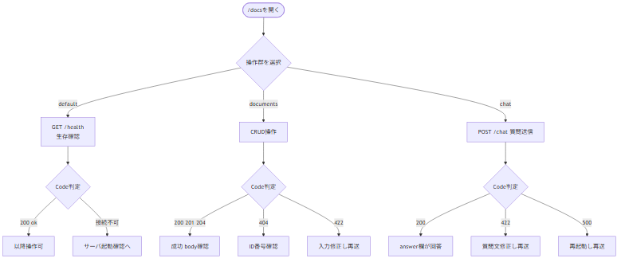

<details>
<summary>図の元データ（Mermaid）</summary>

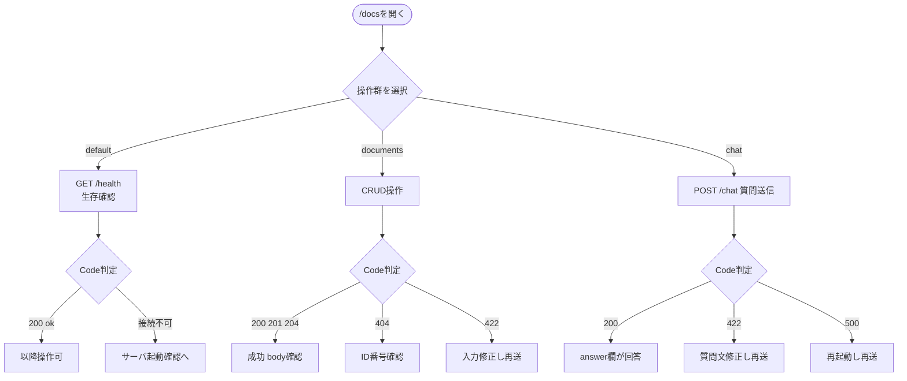
</details>

#### default群 GET /health

| Code | 意味 | 対応 |
|------|------|------|
| 200 body ok | サーバ生存確定です | 以降操作可です |
| 接続自体不可 | サーバ未起動か別ポートです | 起動確認に戻ります |

default群にDELETEは存在しません。`/docs`に表示なしが正常です。

#### documents群

| 操作 | Code | 意味 | 対応 |
|------|------|------|------|
| GET /documents | 200 [] | 登録ゼロで正常です | 異常ではありません |
| GET /documents | 200 件数あり | 登録済み一覧です | body確認です |
| GET /documents/id | 200 | 詳細表示です | body確認です |
| GET /documents/id | 404 | 存在しないIDです | 番号確認です |
| GET /documents/id | 422 | ID欄に数字以外です | 数字に修正します |
| POST /documents | 201 | 登録成功です | 返却idを控えます |
| POST /documents | 422 | titleかcontentが空です | 両方記載し再送します |
| PUT /documents/id | 200 | 更新成功です | 関連検索情報も置換済みです |
| PUT /documents/id | 404 | 対象なしです | id確認です |
| PUT /documents/id | 422 | 入力規則違反です | 空欄修正です |
| DELETE /documents/id | 204 | 削除成功です | bodyなしが正常です |
| DELETE /documents/id | 404 | 対象なしです | id確認です |

#### chat群 POST /chat

| Code | 意味 | 対応 |
|------|------|------|
| 200 answerあり source_idsあり | 会話成立です | answer欄が回答、source_idsが根拠番号です |
| 200 answerあり source_ids空 | 根拠なし回答です | 先に文書登録します |
| 422 | question空です | 1文字以上記入し再送します |
| 500 | 内部障害です | 再起動し再送します。継続時は記録します |

**会話成立条件**：先にPOST /documentsで登録し、次にPOST /chatで質問します。逆順では根拠空になります。

<h4>documents群Codeの決定主体（Rev.C追加）</h4>

<p>結論は、枠組み（FastAPIとPydantic）による自動付与とプロジェクトによる明示選択の混成である。</p>

<p>理由は、型と制約への違反（<code>doc_id:int</code>への数字以外、<code>Field(min_length)</code>への空欄）は枠組みが自動で422と定める一方、201や204や404や500はコード中の明示指定によるためである。</p>

<table>
<tr><th>Code</th><th>決定主体</th><th>根拠</th></tr>
<tr><td>200</td><td>枠組み既定値の採用</td><td>装飾なし時の既定</td></tr>
<tr><td>201</td><td>明示指定</td><td>documents.py:95 POST装飾</td></tr>
<tr><td>204</td><td>明示指定</td><td>documents.py:138 DELETE装飾</td></tr>
<tr><td>404</td><td>明示送出</td><td>documents.py:88,127,151 例外送出</td></tr>
<tr><td>422</td><td>枠組み自動と明示送出の併存</td><td>型制約違反は自動、空欄検査はvalidate_input</td></tr>
<tr><td>500</td><td>明示変換</td><td>chat.py:49,51 例外変換</td></tr>
</table>

<p>具体例として、存在しない番号へのGETは明示由来の404であり、ID欄への数字以外は枠組み由来の422である。</p>

<p>注意点として、DELETEの204はbodyなしが正常であり、異常ではない。</p>

<h4>REST慣行の意味（Rev.C追加）</h4>

<p>結論は、資源（文書）をHTTP動詞で操作する際のCodeの約束事に従うことである。法律ではなく業界の慣行である。</p>

<p>理由は、同じ成功でも意味の区別が必要なためである。読出と更新の成功は200、登録の成功は201、削除の成功は204と使い分ける。対象なしは404、入力違反は422、内部障害は500である。</p>

<table>
<tr><th>操作</th><th>Code</th><th>意味</th></tr>
<tr><td>一覧・詳細・更新</td><td>200</td><td>成功時の返却</td></tr>
<tr><td>登録</td><td>201</td><td>新規作成の合図</td></tr>
<tr><td>削除</td><td>204</td><td>内容なし返却の合図</td></tr>
<tr><td>対象なし</td><td>404</td><td>存在しない番号の通知</td></tr>
<tr><td>入力違反</td><td>422</td><td>規則違反の通知</td></tr>
<tr><td>内部障害</td><td>500</td><td>再起動対象の通知</td></tr>
</table>

<p>具体例として、POST /documentsは201と返却idを返し（documents.py:95）、DELETEは204とbodyなしを返す。</p>

<p>注意点として、200と201と204はいずれも成功であり、数値差は異常ではない。Code判定は5.2対応表で行う。</p>

### 5.3 内部trace（画面の裏側）

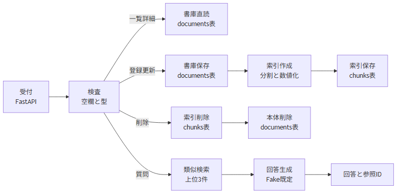

<details>
<summary>図の元データ（Mermaid）</summary>

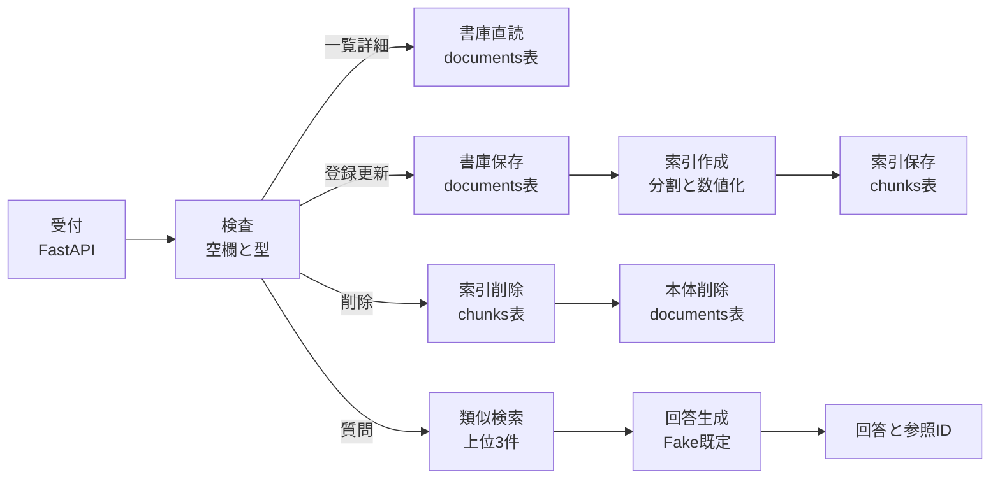
</details>

- 受付はFastAPIが行います。接続は要求ごとに開閉します。
- 検査で空欄と型を確認します。違反は422で返します。
- 一覧と詳細は書庫直読みでRAG不使用です。
- 登録と更新は保存後に索引を作り直します。削除は索引削除が先です。
- 質問は類似検索の上位3件だけを回答生成に渡します。

### 5.4 回答と異常の見分け方

- 成功形は`answer`と`source_ids`を持ちます。Code 200で返ります。
- 失敗形は`detail`と`msg`を持ちます。Code 422等で返ります。
- `/docs`は両雛形を常時表示します。実結果のCodeで判別します。

## 付録：学習の順番

```text
STEP 1: README.md                 → 目的と使い方を理解
STEP 2: config.py                 → 設定値を把握
STEP 3: src/db/models.py          → 2テーブルを把握
STEP 4: src/api/routers/documents.py → CRUDを読む
STEP 5: src/rag/chunker.py        → 分割を読む
STEP 6: src/rag/embeddings.py     → Fakeと本番の切替を読む
STEP 7: src/rag/vectorstore.py    → 保存と検索を読む
STEP 8: src/llm/provider.py       → 切替を読む
STEP 9: src/rag/chain.py          → 回答手順を読む
STEP 10: src/api/routers/chat.py  → 質問応答を読む
STEP 11: tests/                   → 検証内容を読む
STEP 12: diagrams/                → 図で全体を復習
STEP 13: 本書5章                   → 操作と内部の対応を復習
```

---

## 6. Embedding・pgvector・文書ごとの索引更新（Rev.E追加）

<h4>6.1 pgvectorは何をするものか</h4>

<p>結論として、pgvectorはPostgreSQLでベクトルを保存するための拡張機能です。ベクトルは、文章を多数の数値で表したものです。たとえば1024次元のベクトルは、1つの文章を1024個の数値で表します。</p>

<p>理由は、通常のPostgreSQLにはベクトル専用の列型やベクトル演算がないためです。PostgreSQLにpgvectorを導入してDBで有効化すると、<code>Vector(1024)</code>のような列を定義でき、ベクトル向けの演算や索引機能も利用できます。</p>

<p>このプロジェクトでは、<code>src/db/database.py:81-84</code>でPostgreSQLの場合にvector拡張を有効化し、<code>src/db/models.py:48</code>でベクトル列を定義します。ただし、現在の類似検索はpgvectorに距離計算を任せず、<code>src/rag/vectorstore.py:23-36,76-91</code>でチャンクを読み込み、Python側でコサイン類似度を計算します。</p>

<p>環境確認時点（2026-09-29）ではPostgreSQL 18サービスへの接続はできましたが、拡張ファイルが見つからずpgvectorは未導入でした。そのためPostgreSQL＋pgvectorでのテストは保留であり、Ollama＋SQLiteの組合せで実動作を確認しています。</p>

<p>たとえるなら、pgvectorは書庫（PostgreSQL）にベクトル専用の保管棚と道具を追加します。このプロジェクトでは専用棚に保存しますが、近さの計算は現在Python側の担当です。</p>

<h4>6.2 EMBEDDING_DIMはベクトルの長さ</h4>

<p><code>EMBEDDING_DIM</code>は、1つのEmbedding結果に含まれる数値の個数です。文章の件数や文書の数ではありません。コードでは<code>config.py:44</code>に設定し、<code>src/db/models.py:23-48</code>でPostgreSQLの列型に反映します。</p>

<table>
<tr><th>Embedding方式</th><th>1件のベクトル長</th><th>設定例</th></tr>
<tr><td>学習用Fake</td><td>8個</td><td>EMBEDDING_DIM=8</td></tr>
<tr><td>qwen3-embedding:0.6b</td><td>1024個</td><td>EMBEDDING_DIM=1024</td></tr>
</table>

<p>具体例として、Fakeが<code>[0.1, 0.2, ...]</code>のような8個の数値を返す一方、qwen3-embedding:0.6bは1024個の数値を返します。PostgreSQLの列が<code>Vector(8)</code>なのに1024個を保存しようとすると、列の形とデータの形が合わずエラーになります。保存済み文書と質問のベクトルも同じ長さでなければ比較できません。</p>

<p>そのため、qwen3-embedding:0.6bを使う実行環境では<code>EMBEDDING_DIM=1024</code>にします。Fake用の8次元設定と同時に混ぜて使う設定ではありません。SQLiteのJSON列はDB列の型として長さを固定しませんが、保存する文書ベクトルと質問ベクトルの長さは揃える必要があります。</p>

<p>このプロジェクトでOllamaを使う設定例は次のとおりです。実際の設定はGit管理しない<code>.env</code>に記載します。</p>

<pre><code>USE_FAKE=false
LLM_PROVIDER=ollama
OLLAMA_MODEL=qwen3.5:4b
OLLAMA_EMBED_MODEL=qwen3-embedding:0.6b
EMBEDDING_DIM=1024</code></pre>

<h4>6.3 モデルを変更したら、何を作り直すのか</h4>

<p>「モデルが変わるとベクトルを作り直す」という注意は、主にEmbeddingモデルを変更するときの話です。Embeddingモデルは文章を数値に変換する製造元に相当します。製造元が変わると、同じ文章でも数値の並び方や意味の配置が変わるため、新しい製造元で質問を数値化しても、旧製造元の索引カードとは正しく比べられません。</p>

<p>たとえるなら、索引カードの製造元を変更する場合、登録文書のカードを新しい製造元で全部作り直します。質問も同じ製造元でカード化して比較します。古い製造元のカードと新しい製造元のカードを混ぜて近さを比べてはいけません。</p>

<p>変更の影響は次のように分かれます。</p>

<table>
<tr><th>変更</th><th>索引カード（保存ベクトル）の対応</th><th>DB列の変更</th></tr>
<tr><td>チャット生成モデルだけ変更</td><td>通常は作り直し不要。Embeddingモデルが同じなら保存ベクトルを再利用</td><td>通常は不要</td></tr>
<tr><td>Embeddingモデルを変更、次元は同じ</td><td>全チャンクを新Embeddingモデルで再作成</td><td>列の形は同じため通常は不要</td></tr>
<tr><td>Embeddingモデルを変更、次元も変更</td><td>全チャンクを再作成</td><td>ベクトル列を新しい次元に変更または作り直し</td></tr>
</table>

<p>したがって、「異モデル間のベクトル混在検索不可」とは、異なるEmbeddingモデルで作ったベクトルを同じ検索対象に混ぜて、類似度を比較できないという意味です。ここでいう異モデルはEmbeddingモデルです。回答文を作るチャットモデルだけを変更した場合とは区別します。</p>

<p>具体例として、qwen3.5:4bをqwen3.5:9bに替えても、Embeddingモデルをqwen3-embedding:0.6bのままにするなら、保存ベクトルはそのまま使えます。一方、Embeddingを別モデルに替える場合は、次元数が同じでも全チャンクのベクトルを作り直します。</p>

<h4>6.4 /set nothinkingとthink=False</h4>

<p><code>/set nothinking</code>は<code>ollama run</code>のCLIで思考モードを切り替える操作です。RAGを動かす必須条件ではありません。WebアプリはCLIの会話セッションではなくOllamaのHTTP APIを呼び出すため、CLIで行った設定がWebアプリ側へ自動的に引き継がれるとは限りません。</p>

<p>アプリのAPI呼出でも思考モードを使わない設定にしたい場合、<code>ChatOllama(..., think=False)</code>を指定します。これはCLIの設定に相当する振る舞いをAPI呼出側にも明示するものです。モデルやOllama連携ライブラリの対応状況に応じて使います。</p>

<table>
<tr><th>設定</th><th>意味</th></tr>
<tr><td><code>think=False</code></td><td>思考モードを使わないよう指定</td></tr>
<tr><td><code>temperature=0</code></td><td>回答のばらつきを抑える設定。思考モードとは別</td></tr>
<tr><td><code>num_ctx=8192</code></td><td>質問、検索文書、回答などを扱う文脈の上限。思考モードとは別</td></tr>
</table>

<p>このプロジェクトの設定例は<code>src/llm/provider.py:42-48</code>です。<code>think=False</code>は回答方法の調整、<code>temperature</code>と<code>num_ctx</code>は生成時の別の調整項目です。</p>

<h4>6.5 文書1件ごとの操作と索引カード</h4>

<p>「文書操作時」は文書設定ごとではなく、文書の登録・更新・削除APIを1回実行したときです。対象となるのは、そのAPIで指定した文書1件です。</p>

<table>
<tr><th>操作</th><th>対象IDに対して行うこと</th><th>他の文書</th></tr>
<tr><td>POST /documents</td><td>新しい文書を保存し、その文書の索引カードを追加</td><td>変更なし</td></tr>
<tr><td>PUT /documents/2</td><td>ID 2の古いカードだけを外し、新しい本文からカードを作り直す</td><td>ID 1、3などは変更なし</td></tr>
<tr><td>DELETE /documents/2</td><td>ID 2のカードを削除してから、ID 2の文書本体を削除</td><td>ID 1、3などは変更なし</td></tr>
<tr><td>POST /chat</td><td>カードを検索して回答に利用するだけ</td><td>文書・カードを削除しない</td></tr>
</table>

<p>実コードでは、登録時に<code>documents.py:57</code>から対象IDを渡して保存します。更新時も<code>documents.py:132</code>から対象IDを渡します。<code>vectorstore.py:39-60</code>の<code>save_chunks</code>は、そのIDに紐づく既存チャンクだけを置き換えます。削除時は<code>documents.py:152-153</code>で、そのIDのチャンクを先に削除してから文書本体を削除します。</p>

<p>質問時は<code>chain.py:33-36</code>で検索し、回答を作ります。会話のたびにテーブルや文書を削除する処理はありません。</p>

<p>まとめると、普段の文書更新・削除は該当する1件の索引カードだけを扱います。Embeddingモデルやベクトル次元を変更するときだけ、全ての文書の索引カードを一括で作り直す別の移行作業が必要です。</p>

</div>

## 7. Embeddingの出力と次元数（Rev.F追加）

<div style="border-right: 3px solid #c00000; padding-right: 10px;">

<h4>7.1 文書と質問のどちらをEmbeddingするのか</h4>

<p>結論として、登録文書と質問文の両方をEmbeddingします。ただし、チャンクに分割するのは登録文書だけです。文書はチャンクごとにベクトル化し、質問文は分割せず質問全体から1つのベクトルを作ります。</p>

<p>理由は、検索時に質問のベクトルと、登録済み文書の各チャンクのベクトルを比較するためです。長い文書は小さな単位にして個別に検索できるようにしますが、質問は通常そのまま比較できる長さとして扱います。</p>

<table>
<tr><th>対象</th><th>分割</th><th>Embeddingの個数</th></tr>
<tr><td>登録文書</td><td>本文を複数チャンクに分ける</td><td>チャンク1個につき1つ</td></tr>
<tr><td>質問文</td><td>分割しない</td><td>質問1件につき1つ</td></tr>
</table>

<p>実コードでは、登録時に<code>src/api/routers/documents.py:52-58</code>で本文を<code>chunker.split_text</code>に渡し、<code>src/rag/vectorstore.py:39-59</code>で各チャンクをEmbeddingして保存します。質問時は<code>src/rag/vectorstore.py:76-97</code>で質問を検索に使い、<code>src/rag/vectorstore.py:93</code>の<code>embed_query</code>でベクトル化します。<code>src/rag/embeddings.py:81-90</code>では質問1件をEmbeddingし、その1つのベクトルを返します。</p>

<p>具体例として、本文が3チャンクに分かれた場合、文書側には3つのベクトルができます。質問を1件送ると質問側には1つのベクトルができます。質問文を文書のようにチャンク分割してから検索しているわけではありません。</p>

<h4>7.2 1つのチャンクから出るベクトルの形</h4>

<p>Embeddingの出力は、1つのチャンクに対する数値のリストです。リスト内の数値の個数が次元数です。たとえばFakeの8次元設定なら、1チャンクにつき8個の数値が並びます。</p>

<pre><code>チャンクA → [a1, a2, a3, a4, a5, a6, a7, a8]
チャンクB → [b1, b2, b3, b4, b5, b6, b7, b8]
チャンクC → [c1, c2, c3, c4, c5, c6, c7, c8]</code></pre>

<p>この3件をまとめて表すと形は<code>(3, 8)</code>です。最初の3はチャンク数、次の8は1チャンクの次元数です。一方、質問1件のベクトルは<code>[q1, q2, q3, q4, q5, q6, q7, q8]</code>となり、形は<code>(8,)</code>です。つまり、個々のEmbeddingは数値が1列に並んだベクトルであり、複数件をまとめて並べると「件数×次元数」の表になります。</p>

<p>このプロジェクトではFakeは8次元、Ollamaの<code>qwen3-embedding:0.6b</code>は1024次元です。OpenAIはモデルごとに出力次元が異なります。既定の<code>text-embedding-3-small</code>は、コードで次元数を指定していないため標準の1536次元です（<code>src/rag/embeddings.py:68-78</code>）。</p>

<h4>7.3 次元数が多いとどうなるのか</h4>

<p>次元数が多いと、ベクトル1つを表す数値が増えます。モデルによっては、文章の特徴や関係をより細かく表現できる場合があります。ただし、次元数が多いだけで検索精度が必ず上がるわけではありません。精度はEmbeddingモデルの学習内容や性能にも左右されます。</p>

<p>また、次元数が増えると、保存する数値が増え、類似度計算の処理量も増えます。たとえば1024次元のベクトルは、8次元のベクトルより1件あたりの数値を多く保存し、比較時にも多くの数値を計算します。</p>

<p>注意点として、ベクトルの各位置が人間に読める特徴名（「休暇」「日数」など）に対応しているわけではありません。モデルが文章の特徴を数値の組合せとして表現しており、全体のベクトル同士を比較します。また、比較する登録文書と質問には同じEmbeddingモデルを使い、ベクトルの次元数も一致させます。モデルを変更する場合の索引再作成については6.3を参照してください。</p>

<p>PostgreSQLでは<code>EMBEDDING_DIM</code>がベクトル列の長さを決めます。Fakeは8、Ollamaの上記モデルは1024、既定のOpenAIモデルは標準1536であるため、PostgreSQLを使う際は選択したEmbeddingモデルの出力長と設定値を一致させる必要があります。設定値が違うと、ベクトルを列に保存できません。</p>

</div>

---

> このドキュメントは `README.md`、`AGENTS.md`、`config.py` および `src/`、`tests/` の実コードを参照して作成されています。
> 初版 `beginner_overview.md` の継承版（Rev.F）です。Rev.Eの保存内容を維持し、Embeddingの出力形式と次元数の解説を追加しています。
